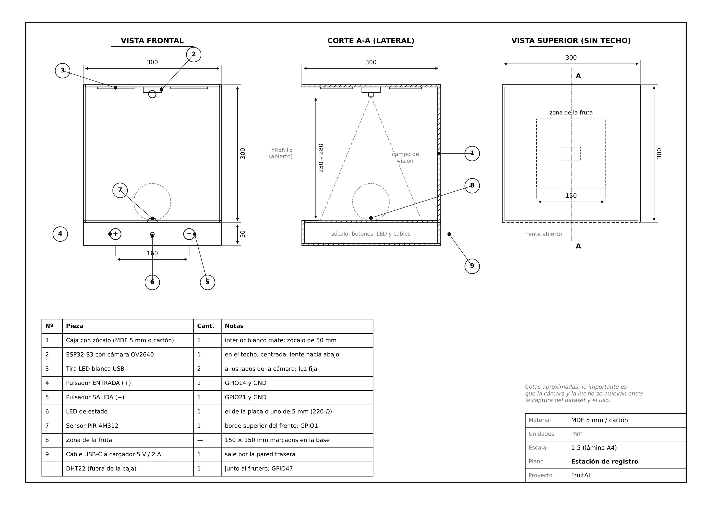
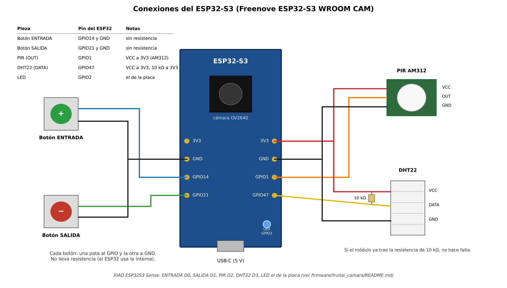

# Mejoras futuras

En el alcance actual FruitAI usa **solo la Raspberry Pi y el ESP32-S3 con cámara**, y todo
se opera desde **Home Assistant**: la cámara se ve en el panel, la fruta reconocida aparece
como "Fruta detectada" y los botones **Entrada / Salida** del panel registran el movimiento
(con la misma lógica anti-duplicados). Por falta de sensores y recursos, lo siguiente quedó
diseñado, y en buena parte programado, pero fuera de esta etapa.

## 1. Estación física de registro

Una caja con fondo e iluminación fijos, pulsadores, LED y sensor de presencia, para
registrar sin el celular. El firmware ya lo soporta: basta con activar las opciones al
inicio de `firmware/fruitai_camara/fruitai_camara.ino`.

| Opción del firmware | Qué activa |
|---|---|
| `USAR_BOTONES 1` | Pulsadores ENTRADA (GPIO14) y SALIDA (GPIO21), a GND, sin resistencia |
| `USAR_PIR 1` | PIR AM312 en GPIO1: activa la cámara 15 s al detectar movimiento (no decide el retiro) |
| `USAR_DHT 1` | DHT22 en GPIO47: temperatura y humedad del frutero en `fruitai/ambiente` |

Los botones físicos y los del panel siguen el mismo camino en el firmware, así que la lógica
anti-duplicados ya probada (24/24 en C++) se aplica igual.

### Materiales adicionales

| Pieza | Cuál | Notas |
|---|---|---|
| Botones | 2 pulsadores (ENTRADA y SALIDA) | mejor grandes, de panel |
| Sensor de presencia | PIR AM312 (3,3 V) o HC-SR501 | |
| Temperatura y humedad | DHT22 | resistencia de 10 kΩ entre DATA y 3V3 si el módulo no la trae |
| LED | el de la placa, o uno de 5 mm + 220 Ω | |
| Cables | protoboard, jumpers macho-hembra | |
| Estación | caja de cartón grueso o MDF de 5 mm, interior blanco mate, tira LED USB blanca | la luz fija es lo que más ayuda al modelo |

### Plano y conexiones





(Se regeneran con `python plano.py`, `python conexiones.py` y `python despliegue.py` desde `docs/hardware/`.)

```
        vista lateral                         vista frontal
   ┌──────────────────────┐              ┌──────────────────────┐
   │   [ESP32 + cámara]   │ ← techo,     │   tira LED (arriba)  │
   │        │  ▼          │   mirando    │                      │
   │   tira LED           │   hacia      │     zona de la       │
   │        ▼             │   abajo      │       fruta          │
   │   ┌──────────┐       │              │   (fondo blanco)     │
   │   │  fruta   │  ← PIR│              ├──────────────────────┤
   │───┴──────────┴───────│              │ (ENTRADA) LED (SALIDA)│
   └──────────────────────┘              └──────────────────────┘
```

- **Caja abierta por delante**, unos 30 × 30 × 30 cm. Base y paredes **blanco mate**
  (cartulina o pintura), sin brillos.
- **Cámara en el techo** mirando hacia abajo, a 25–30 cm de la base, siempre en el
  mismo lugar (fijarla con tornillos o cinta doble faz fuerte). La fruta debe llenar
  buena parte del cuadro.
- **Tira LED** en el techo, junto a la cámara: luz pareja y siempre igual. Es lo que
  más influye en el modelo; que no dependa de la ventana.
- **Panel frontal** con ENTRADA (izquierda), SALIDA (derecha) y el LED en el medio, a la vista.
- **PIR** en el borde delantero, apuntando hacia donde entra la mano.
- **DHT22** junto al frutero (no dentro de la caja, que se calienta con la luz),
  con un cable largo hasta la placa.
- **Alimentación**: el ESP32 y la tira LED con un cargador USB de 5 V / 2 A.

---

## 2. Temperatura y humedad del frutero

El servicio y Home Assistant ya tienen los sensores "Temperatura frutero" y "Humedad
frutero" (MQTT discovery), el agente los incluye en su prompt y existe un firmware de prueba
solo para el DHT22 (`firmware/esp32_ambiente/`). Al instalar el sensor, volver a poner en el
panel la tarjeta del frutero y la gráfica de 24 h (se quitaron del panel porque sin sensor
muestran "desconocido"). `scripts/medir_agente.py` omite la pregunta de temperatura mientras
no haya sensor.

## 3. Modelo de visión

- Fotos propias de **pera y kiwi** (hoy solo tienen imágenes de Fruits-360).
- **Recapturar el conjunto de datos con la cámara del ESP32** y reentrenar con QAT
  (`scripts/entrenar_qat.py`).
- **Robustez a otros ambientes**: fotos en varios lugares y una clase "fondo" más variada.
- **Detección de objetos** (por ejemplo FOMO) para reconocer varias frutas a la vez.

## 4. Datos

- **Pronóstico de consumo** cuando se acumulen varias semanas de historial.
