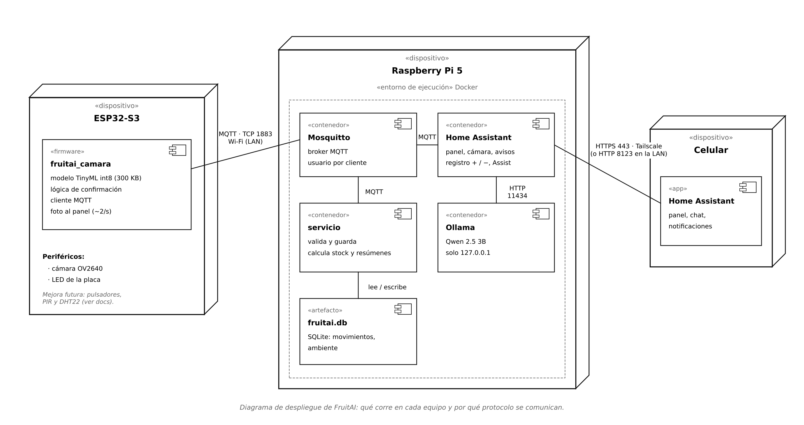

# Puesta en marcha de FruitAI

De las piezas sueltas al sistema funcionando: estación con el ESP32-S3, Raspberry Pi
con todo en Docker, app de Home Assistant en el celular y el chat con Ollama.

Orden recomendado (cada paso se prueba antes de seguir):

1. Raspberry Pi (servidor) → 2. App de HA → 3. Agente de Ollama → 4. ESP32 en la mesa
→ 5. Estación armada → 6. Modelo con la cámara del ESP32 → 7. Prueba final.

**Sin la Raspberry todavía:** todo se puede montar primero en el Mac (sección
"Simular en el Mac y pasar a la Pi", al final) y luego copiarse a la Pi sin repetir
la configuración.

---

## 0. Materiales

| Pieza | Cuál | Notas |
|---|---|---|
| Raspberry Pi | Pi 5 de 8 GB + fuente oficial de 27 W + disipador activo | Ollama usa mucha CPU y RAM |
| Almacenamiento | SSD NVMe con adaptador (recomendado) o microSD de 64 GB clase A2 | El SSD acelera la carga del modelo y la base de datos de HA |
| ESP32-S3 con cámara | Freenove ESP32-S3 WROOM CAM (N8R8 o N16R8) o Seeed XIAO ESP32S3 Sense | Debe tener **PSRAM**; el firmware soporta las dos |
| Cable | USB-C de datos (para cargar el firmware) | |
| Alimentación ESP32 | Cargador USB de 5 V / 2 A | |
| Soporte | Cualquier soporte que mantenga la cámara fija, mirando hacia abajo | Fondo claro y luz pareja |

Botones físicos, PIR, DHT22 y la caja con luz: [mejoras futuras](mejoras_futuras.md).

---

## 1. Raspberry Pi (servidor)

### 1.1 Sistema operativo
1. En el Mac, **Raspberry Pi Imager** → *Raspberry Pi OS Lite (64-bit)*.
2. En la configuración avanzada (engranaje): nombre `raspberrypi`, usuario y clave,
   Wi-Fi (o cable de red, mejor) y **activar SSH**.
3. Grabar, insertar y encender. Desde el Mac: `ssh <usuario>@raspberrypi.local`.

### 1.2 IP fija
En el router, **reservar una IP** para la Raspberry (DHCP reservation). El ESP32 y la
app usan esa IP. Ejemplo: `192.168.1.20`.

### 1.3 Docker y el proyecto
```bash
curl -fsSL https://get.docker.com | sh
sudo usermod -aG docker $USER && exit        # volver a entrar por SSH
git clone -b claude/lucid-gauss-raw1x3 https://github.com/JavierAnd0/ProyectoFrutIA.git
cd ProyectoFrutIA
cp .env.example .env && nano .env            # cambiar TODAS las claves
./scripts/crear_usuarios_mqtt.sh
docker compose --profile ollama up -d --build
docker exec fruitai-ollama ollama pull qwen2.5:3b
docker exec fruitai-ollama ollama pull qwen2.5:1.5b   # para comparar (paso 3.4)
./scripts/fruitai.sh estado                  # los 4 contenedores "Up"
```
Si se va la luz, todo vuelve a arrancar solo (`restart: unless-stopped`).

### 1.4 Home Assistant
1. Navegador: `http://192.168.1.20:8123` → crear el usuario.
2. **Ajustes → Dispositivos y servicios → Agregar integración → MQTT**: broker
   `mosquitto`, puerto `1883`, usuario y clave `MQTT_USUARIO_HA` / `MQTT_CLAVE_HA`.
3. **Reiniciar HA** (Ajustes → Sistema → Reiniciar): así las automatizaciones se
   suscriben a MQTT (ver bitácora, día 2).
4. Debe aparecer el dispositivo **FruitAI** y el panel **FruitAI** en el menú lateral.
5. Prueba sin ESP32: `./scripts/fruitai.sh entrada banano 3` → el panel muestra 3.

Respaldo de todo esto: [restaurar.md](restaurar.md).

---

## 2. App de Home Assistant en el celular

1. Instalar **Home Assistant** (App Store / Google Play).
2. Abrir → encuentra la Pi en la red, o escribir `http://192.168.1.20:8123` → iniciar sesión.
3. Aceptar **notificaciones** y ponerle al celular un nombre sin espacios raros
   (ej. "Javier iPhone"). La app registra la acción `notify.mobile_app_javier_iphone`.
4. Probar el push: en HA → **Herramientas para desarrolladores → Acciones** →
   `script.fruitai_notificar_celulares` con `titulo: Prueba` y `mensaje: Hola` → debe
   llegar al celular. El script avisa a todos los celulares con la app, sin escribir nombres.

Qué llega al celular (`homeassistant/automations.yaml`):
- **Aviso del servicio**: p. ej. "salida rechazada: no hay stock de kiwi".
- **Fruta agotada**: cuando el stock de una fruta pasa a 0 (una vez, al cambiar).

**iPhone y HTTPS:** si el iPhone exige HTTPS (Modo de aislamiento o un perfil), no abre
`http://...:8123` y la app dice "Could not connect to the server". Solución, que además
sirve fuera de casa: **Tailscale**.

1. Instalar Tailscale en el equipo de HA (Mac o Pi) y en el celular, con la misma cuenta.
2. En `login.tailscale.com/admin/dns`: activar **MagicDNS** y **HTTPS Certificates**.
3. En el equipo de HA: `tailscale serve --bg 8123` (la primera vez pide autorizar *Serve*
   con un enlace). Da una dirección `https://<equipo>.<tailnet>.ts.net`.
   En el Mac, el comando está en `/Applications/Tailscale.app/Contents/MacOS/Tailscale`.
4. En HA → **Ajustes → Sistema → Red**:
   - **URL de Home Assistant → Internet**: la dirección `https://...ts.net`.
   - **Proxy inverso**: permitir `X-Forwarded-For` y agregar como proxies de confianza
     `127.0.0.1`, `::1`, `172.16.0.0/12` (Docker en Linux) y `192.168.65.0/24` (Docker
     Desktop en el Mac). Sin esto, HA responde *400: Bad Request* por Tailscale.
     (Antes iba en `configuration.yaml` con `http:`; desde HA 2026.x es desde la interfaz.)
5. En la app del celular: la dirección `https://...ts.net`.

Alternativa de pago: **Nabu Casa**.

---

## 3. Agente de Ollama (el chat)

Cómo funciona: las preguntas comunes ("¿cuántas peras hay?") las responden las
**oraciones locales** al instante y sin error (`homeassistant/custom_sentences/es/`).
Solo lo que no encaja ahí ("¿qué fruta se está acabando?") va a **Ollama**.

### 3.1 Integración
**Ajustes → Dispositivos y servicios → Agregar integración → Ollama**:
- URL: `http://ollama:11434`
- Modelo: `qwen2.5:3b`

### 3.2 Configurar el agente (botón **Configurar** de la integración)
| Opción | Valor | Por qué |
|---|---|---|
| Nombre | `FruitAI qwen2.5 3b` | `medir_agente.py` busca los agentes con "fruitai" en el nombre |
| **Instrucciones** | pegar todo `docs/prompt_agente.txt` | Le da los datos y los totales ya calculados |
| **Controlar Home Assistant** | **desactivado / ninguno** | Un modelo de 3B se pierde intentando usar herramientas; probable causa del 0/10 de la primera medición |
| Mantener vivo (keep alive) | `-1` | El modelo no se descarga de la memoria entre preguntas |
| Mensajes de historial | 5 o menos | Prompt más corto = respuesta más rápida |

### 3.3 Asistente
**Ajustes → Asistentes de voz → Agregar asistente**:
- Nombre `FruitAI`, idioma **Español**, agente de conversación **FruitAI qwen2.5 3b**.
- Activar **"Preferir el manejo local de comandos"**: primero las oraciones locales,
  después Ollama.
- Marcarlo como asistente **preferido** (estrella). En la app, Assist usa ese.

### 3.4 Medir en la Raspberry
1. Perfil de HA → **Seguridad → Tokens de acceso de larga duración** → crear y poner
   `HA_TOKEN=...` en el `.env` de la Pi.
2. Repetir 3.1–3.2 con `qwen2.5:1.5b` (nombre `FruitAI qwen2.5 1.5b`) para comparar.
3. Cargar datos variados (para que las preguntas abiertas tengan respuesta clara):
   ```bash
   ./scripts/fruitai.sh entrada manzana 5 && ./scripts/fruitai.sh entrada banano 3
   ./scripts/fruitai.sh entrada pera 1 && ./scripts/fruitai.sh salida banano
   ```
4. Medir:
   ```bash
   python3 scripts/medir_agente.py --repeticiones 3 --equipo "Raspberry Pi 5 8 GB"
   ```
   El informe queda en `docs/resultados/agente_<fecha>.md`, con tiempo, RAM y aciertos
   separados en **comunes** (las cubren las oraciones locales) y **abiertas** (solo Ollama).
5. Elegir el modelo con el mejor equilibrio entre aciertos en abiertas y tiempo.

---

## 4. ESP32-S3 con cámara

Probar por partes:

1. **Placa y cámara**: Arduino IDE → ejemplo `CameraWebServer` con el modelo de placa
   correcto → abrir la IP en el navegador y ver imagen. Si esto falla, el resto también.
2. **Firmware principal**: [firmware/fruitai_camara/README.md](../firmware/fruitai_camara/README.md)
   (conexiones, librerías y compilación). En el monitor serie: `MQTT OK` y líneas `ve: ...`.
3. En el panel FruitAI: la cámara se ve, "ESP32 conectado" está activo y, con una fruta
   delante, "Fruta detectada" la muestra. Pulsar **Entrada** → el stock cambia.

**Pendiente — modelo en el firmware:** el firmware usa la librería Arduino que genera
Edge Impulse. El modelo v5 (QAT) se entrenó fuera de Edge Impulse, así que hay que
subirlo a Edge Impulse ("Upload your model", BYOM) para generar la librería, o cargarlo
con TensorFlow Lite Micro. Se resuelve en el paso 6, junto con el reentrenamiento.

---

## 5. Ubicación de la cámara

En el alcance actual no hay estación física: el ESP32-S3 va fijo en un soporte, mirando
hacia abajo a una superficie de fondo claro y uniforme, a unos 25–30 cm, con luz pareja que
no dependa de la ventana. Lo importante es que **la cámara y la luz no se muevan** entre la
captura de las fotos de entrenamiento y el uso. Se alimenta con un cargador USB de 5 V / 2 A.

Todo se opera desde Home Assistant (panel FruitAI): la cámara, "Fruta detectada" y los
botones **Entrada / Salida**.



La estación completa (caja con luz, pulsadores, PIR y DHT22, con plano y conexiones) quedó
como mejora futura: [mejoras_futuras.md](mejoras_futuras.md).

---

## 6. Modelo con la cámara del ESP32

Con la cámara ya en su lugar (las fotos deben ser exactamente como las verá en uso):

1. Capturar con la cámara del ESP32, en su ubicación definitiva: 40–60 fotos por fruta (varias
   frutas de cada tipo, distintas posiciones, con y sin mano, de día y de noche) y
   ~100 de fondo (vacía, mano sola, sombras).
2. Subirlas a Edge Impulse, reentrenar y aplicar QAT (`scripts/entrenar_qat.py`).
3. Evaluar con `scripts/evaluar_modelo.py`, generar la librería y cargarla en el ESP32.

---

## 7. Prueba final (objetivo específico 6)

20 movimientos reales mezclando frutas, entradas y salidas, incluyendo los casos
difíciles (pulsar Entrada dos veces en el panel, cambiar de fruta sin retirarla, salida
con stock 0).
Anotar por cada uno: fruta, tipo, si se registró bien y el tiempo hasta confirmar.
Comparar con la tabla `movimientos` de SQLite (`./scripts/fruitai.sh db`).

---

## Simular en el Mac y pasar a la Pi

El mismo `docker-compose.yml` corre en el Mac. Todo el estado (HA, base de datos,
usuarios MQTT, claves) vive en la carpeta del proyecto, así que se configura una vez
en el Mac y se copia a la Pi.

### En el Mac
```bash
git pull origin claude/lucid-gauss-raw1x3
docker compose --profile ollama up -d --build
docker exec fruitai-ollama ollama pull qwen2.5:3b
```
- HA en `http://localhost:8123` (si ya estaba configurado: reiniciarlo para cargar las
  automatizaciones nuevas). Seguir las secciones 1.4, 2 y 3 igual que en la Pi.
- App del celular: `http://<IP del Mac>:8123` (`ipconfig getifaddr en0`), mismo Wi-Fi.
- Flujo completo con el ESP32 virtual **con MQTT**:
  `.venv/bin/python simulador/esp32_virtual.py --modelo modelos/fruitai.tflite`
- `medir_agente.py` en el Mac sirve para revisar aciertos; los **tiempos** del documento
  se miden en la Pi (Ollama en Docker en el Mac es mucho más lento).

### Pasar a la Pi
1. En la Pi: secciones 1.1–1.3 (sistema, IP fija, Docker, clonar), **sin** levantar aún.
2. En el Mac:
   ```bash
   docker compose stop
   rsync -av homeassistant data mosquitto .env <usuario>@raspberrypi.local:~/ProyectoFrutIA/
   ```
3. En la Pi:
   ```bash
   cd ~/ProyectoFrutIA && docker compose --profile ollama up -d --build
   docker exec fruitai-ollama ollama pull qwen2.5:3b
   ```
4. Cambiar la dirección del Mac por la de la Pi en la **app** (Ajustes de la app →
   Servidor) y en el **ESP32** (`MQTT_HOST` en `secrets.h`).
